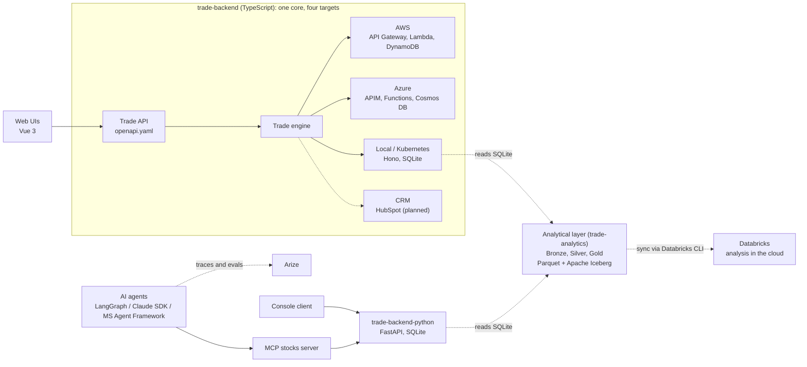

# Stock Market Simulator

[](https://github.com/alexbcbr/stock-market-simulator/actions/workflows/ci-python.yml)
[](https://github.com/alexbcbr/stock-market-simulator/actions/workflows/ci-typescript.yml)
[](https://sonarcloud.io/project/overview?id=alexbcbr_stock-market-simulator)
[](LICENSE)

An educational, intraday trading game. Players buy and sell stocks against **real historical market prices**, with no real money and no live market connection.

It is also a teaching tool for a bigger question: **how can AI agents safely run critical workloads?** A trade is a small but realistic critical transaction, with pricing rules, success or failure, and authorization that must behave the same whether a person or an AI agent triggers it.

## Highlights

- **One set of rules, many platforms.** The trade engine is written once in TypeScript and runs on AWS, Azure, local and Kubernetes, behind a single OpenAPI contract.
- **AI agents as first-class users.** A financial assistant places trades through a narrow tool interface (MCP). It is implemented three ways: LangChain/LangGraph, the Claude Agent SDK and the Microsoft Agent Framework.
- **Analytics-ready data.** A daily pipeline ([`trade-analytics/`](trade-analytics/)) copies the trades into bronze, silver and gold layers (Parquet, with Apache Iceberg for silver and gold) and syncs them to Databricks for analysis.
- **Measured, not guessed.** Agent behavior is traced and scored with LLM-as-judge evals against golden datasets (Arize).
- **Spec-driven.** Mission, tech stack, roadmap and per-feature requirements live in [`specs/`](specs/).

## Architecture



The Python backend is a separate implementation of the same domain, used by the console client and the AI agents. The analytics layer reads the SQLite database of either backend. More diagrams are in [`specs/system-diagram.md`](specs/system-diagram.md).

## Repository layout

| Folder | What it is |
|---|---|
| [`trade-backend/`](trade-backend/) | TypeScript backend: trade engine, API contract and deployments for AWS (CDK), Azure (Terraform), local and Kubernetes |
| [`trade-backend-python/`](trade-backend-python/) | FastAPI backend with SQLite, Dockerfile and Kubernetes manifest |
| [`trade-ui/`](trade-ui/), [`trade-ui-basic/`](trade-ui-basic/) | Vue 3 + Vite frontends: trades, market prices and leaderboard |
| [`trade-console/`](trade-console/) | Terminal client for the FastAPI backend |
| [`trade-ai/`](trade-ai/) | Financial assistant (LangChain/LangGraph) and the MCP stocks server |
| [`trade-ai-claude-agent-sdk/`](trade-ai-claude-agent-sdk/), [`trade-ai-microsoft-agent-framework/`](trade-ai-microsoft-agent-framework/) | The same assistant on other agent frameworks |
| [`trade-ai-crewai/`](trade-ai-crewai/) | CrewAI crew (researcher, writer, reviewer) that writes a brief with talking points per customer |
| [`trade-analytics/`](trade-analytics/) | Analytics pipeline: bronze, silver and gold layers (Parquet and Apache Iceberg), synced to Databricks |
| [`evals/`](evals/) | Datasets and the LLM-as-judge pipeline |
| [`yahoo-finance-stocks/`](yahoo-finance-stocks/) | Market data importers and CSVs |
| [`specs/`](specs/), [`design/`](design/), [`docs/`](docs/) | Specs, architecture diagrams and generated API docs |

## Getting started

**Prerequisites:** [bun](https://bun.sh) for the TypeScript projects and [uv](https://docs.astral.sh/uv/) for the Python ones.

Run the full game locally (backend on SQLite plus the web UI):

```bash
# 1. Backend on http://localhost:8080 (seeds the database on first run)
cd trade-backend
bun install
make run-local

# 2. Web UI, in another terminal
cd trade-ui
bun install
echo 'VITE_URL_TRADE_SERVICES=http://localhost:8080/' > .env
bun run dev
```

Check any deployment (local, Kubernetes, AWS or Azure) with the shared smoke test:

```bash
cd trade-backend
make smoke URL=http://localhost:8080
```

Other targets:

| Target | Guide |
|---|---|
| Kubernetes (Docker Desktop) | `make k8s-build k8s-apply` in `trade-backend/`, see [`deploy/k8s`](trade-backend/deploy/k8s/) |
| AWS | `bun run cdk deploy --all`, see [`deploy/README.md`](trade-backend/deploy/README.md) |
| Azure | Terraform, see [`deploy/azure-terraform`](trade-backend/deploy/azure-terraform/) |
| FastAPI backend | `make run-local` in `trade-backend-python/` (port 8000) |
| Analytics | `uv run bronze_pipeline.py`, `silver_pipeline.py`, `gold_pipeline.py` in `trade-analytics/` (needs `FILE_PATH` in `.env`), then `upload_to_databricks.py` to sync. See [`trade-analytics/README.md`](trade-analytics/README.md) |
| AI assistant | Start the FastAPI backend, then `uv run stock_mcp_server.py` and an agent in `trade-ai/`. Needs AWS Bedrock credentials and, for tracing, Arize keys in a `.env` file |

## Analytics

[`trade-analytics/`](trade-analytics/) turns the trades into a data mart for analysis, as a daily batch in three layers:

| Layer | Content |
|---|---|
| Bronze | Raw Parquet copy of every SQLite table, one file per table per day |
| Silver | `trade_market`: one row per trade joined with symbol and price data (Parquet files managed as an Apache Iceberg table) |
| Gold | `daily_customer_symbol`: one row per date, customer and symbol, with trade count and total executed price (Apache Iceberg), so queries by customer and day are fast |

The three layers are synced to a Databricks volume with the Databricks CLI, for analysis in the cloud. The local pipeline stays the source of truth. Details: [`specs/features/F-011-trade-analytics/`](specs/features/F-011-trade-analytics/).

## How a trade is priced

Each order uses one `price_mode`. The range is `highest - lowest` of the day.

| Mode | Executed price | Outcome |
|---|---|---|
| `market` | Random from 48% of the range up to the high | Always succeeds |
| `agent_aggressive`, `agent_moderate`, `agent_conservative` | Random within the lower 50%, 5-45% or 10-40% of the range | Always succeeds |
| `manual` | The player's bid, capped at the high | Fails at or below the low. In between, it succeeds only if a random point in the range lands above 45% |

The rules live in [`trade-backend/src/core/tradeEngine.ts`](trade-backend/src/core/tradeEngine.ts).

## Testing and quality

```bash
cd trade-backend && bun test       # engine, repository contract, API and template tests
cd trade-backend-python && uv run pytest
```

GitHub Actions runs on every pull request into `main`:

- **Python:** ruff lint and format checks, and Pyright type checks for each project.
- **TypeScript:** build and tests for the backend, lint and build for both UIs.
- **Security:** secret scanning on every push, plus local pre-commit and Claude Code guardrails against committing secrets.

Source code is also scanned for vulnerabilities and code smells by SonarQube Cloud. The latest results are on the [project dashboard](https://sonarcloud.io/project/overview?id=alexbcbr_stock-market-simulator).

## Documentation

- [`specs/mission.md`](specs/mission.md): purpose, users, principles and non-goals
- [`specs/tech-stack.md`](specs/tech-stack.md): what each project uses and why
- [`specs/roadmap.md`](specs/roadmap.md) and [`specs/features/`](specs/features/): feature requirements, plans and validation
- [`trade-backend/api-contract/openapi.yaml`](trade-backend/api-contract/openapi.yaml): the API contract shared by every target
- API reference generated with TypeDoc and pydoc (`make typedoc`, `make pydoc`) into [`docs/`](docs/)

## Roadmap

The baseline (trade execution, market prices, leaderboard, multi-target backend, AI assistant, evals) is implemented. Next:

- Close baseline gaps: page the list routes, date-aware trade timestamps, unify the two UIs, and align the Python rules with the TypeScript core.
- Voice interaction with the data.
- Kafka-driven PDF reports.

See [`specs/roadmap.md`](specs/roadmap.md) for the full plan.

## Contributing

Work happens on `dev` and reaches `main` through a pull request that passes CI. Use bun (not npm) and uv (not pip), and keep one lockfile per project. Run `make setup-hooks` once after cloning to enable the pre-commit secret check.

## License

[MIT](LICENSE) © 2026 Alex BC
