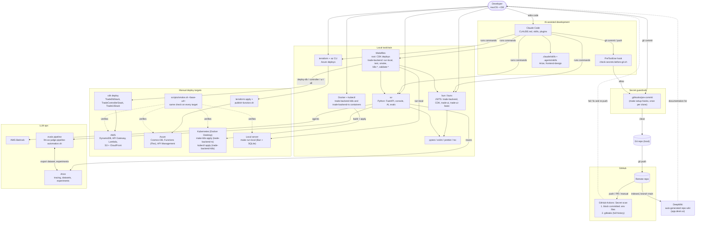
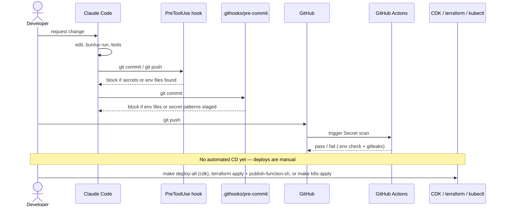

# Development Environment Diagram

Tools, CI/CD and how they relate in the day-to-day workflow. CI is currently limited to secret scanning; deployments are run manually from the developer machine.

## Tooling and workflow

## Commit-to-deploy sequence

## Notes

- **Three secret layers:** Claude Code hook (Claude-initiated commits/pushes), tracked `pre-commit` (anyone), GitHub Actions (after push).
- **Wiki:** the project wiki lives in DeepWiki: <https://app.devin.ai/org/alexbcbr/wiki/alexbcbr/stock-market-simulator?branch=main>
- **Package managers:** bun for JS/TS, uv for Python. Don't reintroduce `package-lock.json` (two lockfiles break CDK synth).
- **Four targets, one check.** AWS (CDK), Azure (Terraform + `publish-function.sh`), local (`make run-local`) and Kubernetes (`make k8s-apply`) are all verified with `scripts/smoke.sh <base-url>`. Details: `trade-backend/deploy/README.md`.
- **Not automated today:** build, tests and deploys have no CI; they run locally. CD could be added as a workflow that runs `bun run build` + `cdk deploy`, or `terraform apply` for Azure.
