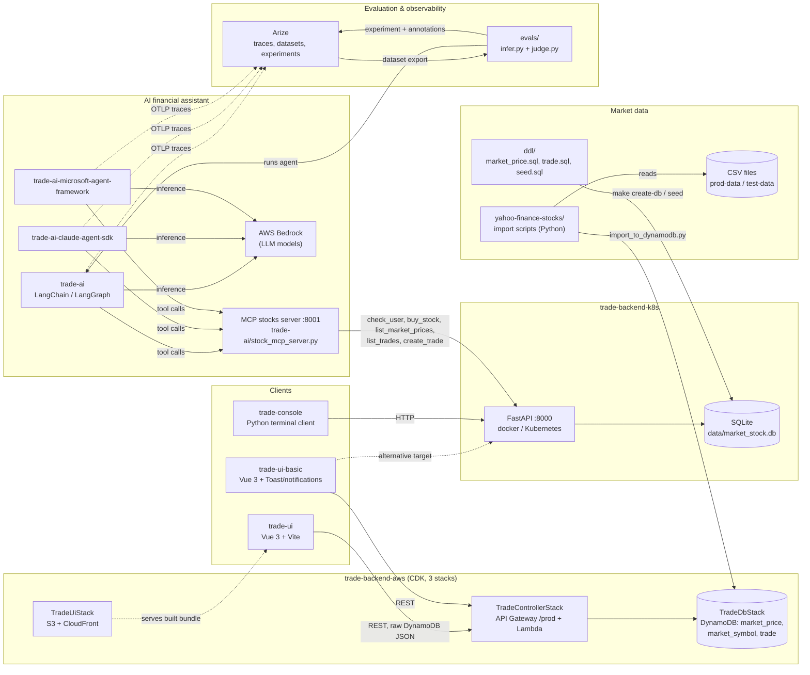

# System Diagram

How the projects in this monorepo connect. Two interchangeable backends serve the same domain (trades, market prices); the UIs, console client and AI agents talk to one of them.

## Notes

- **Two backends, one domain.** AWS (DynamoDB + Lambda) and FastAPI (SQLite) implement the same domain separately; trade-execution logic may differ, so check each one.
- **The AI agents only use the FastAPI backend**, through the MCP server (`:8001`) which calls FastAPI (`:8000`). Start order: FastAPI → MCP server → agent.
- **UI data shape.** Against the AWS backend the UI parses raw DynamoDB JSON in its Pinia stores.
- **Market data** is loaded into DynamoDB by `yahoo-finance-stocks/` and into SQLite from `ddl/`.
- Dashed lines are optional/alternative or non-request paths (static hosting, tracing).
