# System Diagram

How the projects in this monorepo connect. The TypeScript `trade-backend` runs on four targets (AWS, Azure, local, Kubernetes) from one core and one API contract; the Python `trade-backend-python` is a separate implementation of the same domain. The UIs, console client and AI agents talk to one backend at a time.

```mermaid
flowchart LR
    subgraph Data["Market data"]
        YF["yahoo-finance-stocks/<br/>import scripts (Python)"]
        CSV[("CSV files<br/>prod-data / test-data")]
        DDL["ddl/<br/>market_price.sql, trade.sql, seed.sql"]
    end

    subgraph Clients["Clients"]
        UI["trade-ui<br/>Vue 3 + Vite"]
        UIB["trade-ui-basic<br/>Vue 3 + Toast/notifications"]
        CON["trade-console<br/>Python terminal client"]
    end

    subgraph TB["trade-backend (TypeScript, bun) - one core, four targets"]
        CONTRACT["api-contract/openapi.yaml<br/>plain JSON, same on every target"]
        SMOKE["scripts/smoke.sh &lt;base-url&gt;<br/>15 checks per target"]
        CORE["src/core<br/>pricing rules, TradeService,<br/>validation, repository ports"]
        HONO["src/api/app.ts<br/>Hono routes"]

        subgraph AWS["AWS (deploy/aws-cdk, 3 CDK stacks)"]
            CF["TradeUiStack<br/>S3 + CloudFront"]
            APIGW["TradeControllerStack<br/>API Gateway /prod"]
            LAM["Lambda handlers<br/>buy, sell, price, symbol, customer"]
            ADPD["DynamoDB adapter"]
            DDB[("TradeDbStack<br/>DynamoDB: market_price,<br/>market_symbol, trade, customers")]
        end

        subgraph AZ["Azure (deploy/azure-terraform)"]
            APIM["API Management<br/>imports openapi.yaml"]
            FUNC["Azure Function<br/>Hono app, managed identity"]
            ADPC["Cosmos adapter"]
            COSMOS[("Cosmos DB serverless<br/>market_price, market_symbol, trade, customers")]
        end

        subgraph LOCAL["Local and Kubernetes (deploy/k8s)"]
            SRV["Bun server :8080<br/>make run-local / container"]
            ADPS["SQLite adapter (Drizzle)"]
            SQL2[("SQLite<br/>data/trade.db or PVC")]
        end
    end

    subgraph K8S["trade-backend-python"]
        API["FastAPI :8000<br/>docker / Kubernetes"]
        SQLITE[("SQLite<br/>trade-backend-python/data/market_stock.db")]
    end

    subgraph AI["AI financial assistant"]
        MCP["MCP stocks server :8001<br/>trade-ai/stock_mcp_server.py"]
        AG1["trade-ai<br/>LangChain / LangGraph"]
        AG2["trade-ai-claude-agent-sdk"]
        AG3["trade-ai-microsoft-agent-framework"]
        BED["AWS Bedrock<br/>(LLM models)"]
    end

    subgraph ANL["Analytical layer (trade-analytics, daily batch)"]
        BRZ["Bronze<br/>raw Parquet, one file per table per day"]
        SLV["Silver: silver.trade_market<br/>Parquet + Apache Iceberg"]
        GLD["Gold: gold.daily_customer_symbol<br/>Parquet + Apache Iceberg"]
        EXP["upload_to_databricks.py<br/>exports Iceberg to plain Parquet"]
    end
    DBX["Databricks (cloud)<br/>Unity Catalog volume, for analysis"]

    subgraph Obs["Evaluation & observability"]
        ARIZE["Arize<br/>traces, datasets, experiments"]
        EVALS["evals/<br/>infer.py + judge.py"]
    end

    %% data loading
    YF -->|reads| CSV
    YF -->|import_to_dynamodb.py| DDB
    CSV -->|scripts/seed.ts, baked into image| SQL2
    CSV -->|scripts/seed-cosmos.ts| COSMOS
    DDL -->|make create-db / seed| SQLITE

    %% one core behind every target
    LAM --> CORE
    HONO --> CORE
    SRV --> HONO
    FUNC --> HONO
    CORE -->|ports| ADPD
    CORE -->|ports| ADPC
    CORE -->|ports| ADPS
    ADPD --> DDB
    ADPC --> COSMOS
    ADPS --> SQL2

    %% request paths per target
    APIGW --> LAM
    APIGW -->|"VTL templates, no Lambda<br/>(list routes, plain JSON)"| DDB
    APIM --> FUNC
    CONTRACT -.->|defines routes and shapes| APIGW
    CONTRACT -.->|imported by| APIM
    CONTRACT -.->|implemented by| HONO
    SMOKE -.->|verifies| APIGW
    SMOKE -.->|verifies| APIM
    SMOKE -.->|verifies| SRV

    %% UI delivery + calls
    CF -.->|serves built bundle| UI
    UI -->|REST, plain JSON| APIGW
    UI -.->|alternative target| APIM
    UI -.->|alternative target| SRV
    UIB -->|REST, plain JSON| APIGW
    UIB -.->|alternative target| API
    CON -->|HTTP| API
    API --> SQLITE

    %% analytics
    SQL2 -.->|bronze_pipeline.py, via FILE_PATH| BRZ
    SQLITE -.->|bronze_pipeline.py, via FILE_PATH| BRZ
    BRZ -->|silver_pipeline.py| SLV
    SLV -->|gold_pipeline.py| GLD
    BRZ --> EXP
    SLV --> EXP
    GLD --> EXP
    EXP -->|Databricks CLI: fs cp| DBX

    %% AI path
    AG1 & AG2 & AG3 -->|tool calls| MCP
    MCP -->|check_user, buy_stock, list_market_prices,<br/>list_trades, create_trade| API
    AG1 & AG2 & AG3 -->|inference| BED
    AG1 & AG2 & AG3 -.->|OTLP traces| ARIZE
    ARIZE -->|dataset export| EVALS
    EVALS -->|runs agent| AG1
    EVALS -->|experiment + annotations| ARIZE
```

## Notes

- **One core, four targets.** `trade-backend/src/core` holds the pricing rules, validation and repository ports. Each target only adds a thin entrypoint plus one storage adapter (DynamoDB, Cosmos DB or SQLite), so a rule change is made once.
- **One contract.** `api-contract/openapi.yaml` defines the routes and plain-JSON shapes. AWS answers it through API Gateway, Azure imports it into API Management, and the Hono app implements it for local and Kubernetes. `scripts/smoke.sh <base-url>` checks any deployment against it.
- **AWS keeps API Gateway.** The three list routes (`listAllTrades`, `listTradesByCustomerName`, `listMarketPrices`) go straight to DynamoDB through VTL mapping templates with no Lambda; the templates convert DynamoDB-typed items to plain JSON. The other routes go through Lambda handlers that call the core.
- **Azure** is defined in Terraform and verified offline only so far (see `trade-backend/deploy/README.md`). Local and Kubernetes share the same Bun server; on Kubernetes SQLite sits on a PVC, so there is one replica.
- **`trade-backend-python` is separate.** The Python FastAPI + SQLite backend implements the same domain on its own, so its trade logic may differ; check it separately. Its Kubernetes names (`trade-backend`) differ from the TypeScript ones (`trade-backend-ts`).
- **The AI agents only use the FastAPI backend**, through the MCP server (`:8001`) which calls FastAPI (`:8000`). Start order: FastAPI -> MCP server -> agent.
- **UI data shape.** Both UIs expect plain JSON from the TypeScript backend on every target; they no longer parse DynamoDB-typed JSON.
- **Market data** is loaded into DynamoDB by `yahoo-finance-stocks/`, into the TypeScript backend's SQLite and Cosmos DB from the same CSVs by `scripts/seed.ts` and `scripts/seed-cosmos.ts`, and into the Python backend's SQLite from `ddl/`.
- **Analytical layer.** `trade-analytics/` reads the SQLite file of either backend (`FILE_PATH`) and builds bronze (raw Parquet), silver and gold (Parquet files managed as Apache Iceberg tables with a local SQLite catalog). Iceberg metadata holds local paths, so silver and gold are exported to plain Parquet before the upload; Databricks receives bronze, silver and gold in a Unity Catalog volume and is the analysis side only. See F-011.
- Dashed lines are optional/alternative or non-request paths (static hosting, tracing, contract and verification links).
- 2 branches (dev and main)
- GitHub workflows as my CI/CD
